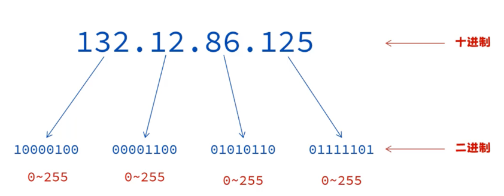
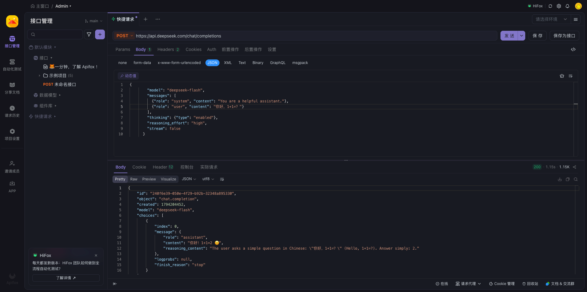

## AI大模型

- AI大模型：也称为大语言模型(Large Language Modele,`LLM`),是AI技术的一个分支。其实就是一个用代码模拟人脑神经网络的程序(参数量极其庞大，通常达到数十亿至熟千亿级别)，通过大量的数据训练后，使其具备理解人类语言、思考、推理并输出人类语言的能力。


## AI应用
- 是指将AI大模型技术落地到具体的业务场景中，用来解决实际问题的产品或者服务。


## 大模型部署

- 本地部署
  - 优点：数据安全、自主可控、长期成本低
  - 缺点：初始成本高、需长期维护、性能受限
- 官方开放API
  - 优点：前期成本低、无需部署和维护、随时访问
  - 缺点：隐私不能保障、长期成本高、可控性差
- 云服务平台（如阿里云百炼、百度千帆、火山引擎）
  - 优点：前期成本低、无需部署和维护、选择度高
  - 缺点：安全及隐私不能保障、长期成本高

### 大模型部署-本地部署

- ollama是一个在本地运行、管理大语言模型的工具。官网：https://ollama.com


### 大模型部署-官方开放API

- 主流的大模型(如：DeepSeek、Kimi等)官方都提供了开放APi，无需部署，就可以直接调用访问


## 大模型调用

### 网络基础知识

- 网络，也就是我们通常说的互联网，就是由无数个计算机网络设备连接起来形成的全球性的网络基础设施。
- IP - 可以理解为就是设备在互联网中的地址(唯一身份证)，每个连入网络的设备都有一个自己的IP地址，用来定位设备在互联网中的位置。
  - IPv4地址：32位二进制
  
  - IPv6地址：128位二进制(解决IPv4不够用的问题)

> 127.0.0.1是一个非常特殊的Ip地址，表示的是本机地址(也称为本机的回环地址)


### Apifox测试
参考：https://api-docs.deepseek.com/zh-cn/




#### 会话记忆 -现状

我们先看一个例子：

```json
{
  "messages": [
    {"role": "system", "content": "你是一个数学家"},
    {"role": "user", "content": "有12个苹果，现在有三个人，怎么均分？"}
  ]
}
```


```json
{
    "message": {
        "role": "assistant",
        "content": "12个苹果平均分给3个人：  \n**每人分4个苹果**。",
        "reasoning_content": "我们需要回答中文。问题：有12个苹果，三个人怎么均分？简单：每人4个。可能脑筋急转弯？均分苹果：12/3=4。直接回答。需要简洁。"
    },
}
```

我们继续提问

```json
{
  "messages": [
    {"role": "system", "content": "你是一个数学家"},
    {"role": "user", "content": "那两个人呢？"}
  ]
}
```

```js

{
  "message": {
      "role": "assistant",
      "content": "你指的“那两个人”是谁？我这边没有前文上下文，能不能补充一下他们的名字、题目背景，或者把完整问题再发一遍？",
      "reasoning_content": "我们需要回答用户“那两个人呢？”但缺乏上下文。需要澄清指哪两个人。作为数学家？可能需要问前文。用中文回复。要表达不知道“那两个人”指谁，请提供上下文/名字/题目。简短。"
  }
}
```

结果可以看到，并没有回答正确。

> 与AI大模型的交互本质上是无状态的，每一次请求响应都是相互独立的。

#### 会话记忆-处理方案(滚雪球方案)

```json
{
  "messages": [
    {"role": "system", "content": "你是一个数学家"},
    {"role": "user", "content": "有12个苹果，现在有三个人，怎么均分？"},
    {"role": "assistant", "content": "我们需要回答中文。问题：有12个苹果，三个人怎么均分？简单：每人4个。可能脑筋急转弯？均分苹果：12/3=4。直接回答。需要简洁。"},
     {"role": "user", "content": "那两个人呢？"}
  ]
}
```

```json
{
    "message": {
        "role": "assistant",
        "content": "12个苹果分给两个人，每人 **6个**。",
        "reasoning_content": "我们需要回答中文。上下文：12个苹果三个人均分每人4。问那两个人呢？可能12个苹果分给两个人，每人6个。要简洁。注意“那两个人呢？” 可以理解为如果只有两个人怎么均分：12÷2=6，每人6个。回答。"
    }
}
```

## 提示词工程

- 提示词(Prompt)：是引导大模型(LLM)进行内容生成的命令(一句话、一个问题等)。
- 提示词工程：通过有技巧的编写提示词，使大模型生成出尽可能符合预期的内容，这一持续性的过程就称为提示词工程。
