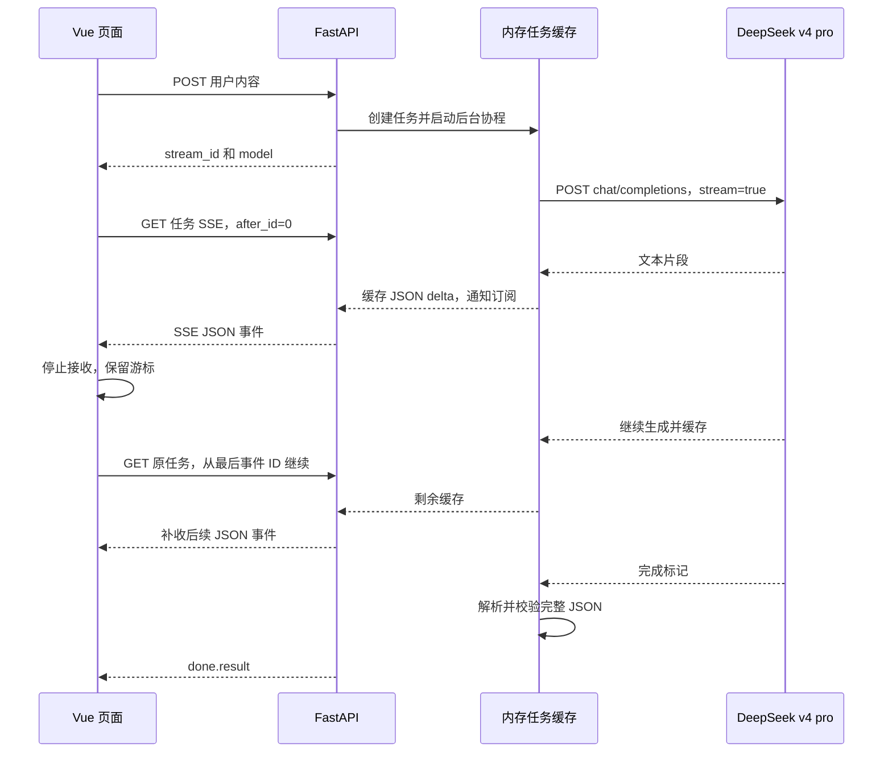

# 后端核心代码与流程说明

后端通过 DeepSeek 官方接口获取真实模型输出，再将结果转换成 JSON SSE 事件。模型为 `deepseek-v4-pro`，地址为 `https://api.deepseek.com/v1`。前端调用逻辑见[前端说明](frontend-guide.md)。

## 1. 文件职责

| 文件 | 作用 |
| --- | --- |
| [src/fastapi_demo/main.py](../src/fastapi_demo/main.py) | 加载本地配置、创建 HTTP 客户端和任务存储、注册路由及静态页面 |
| [src/fastapi_demo/conversations.py](../src/fastapi_demo/conversations.py) | 存储选择、共享上下文规则及可选 SQLite 存储 |
| [src/fastapi_demo/mysql_conversations.py](../src/fastapi_demo/mysql_conversations.py) | MySQL 问答存储、事务与历史迁移 |
| [src/fastapi_demo/mysql_schema.sql](../src/fastapi_demo/mysql_schema.sql) | MySQL 建表语句 |
| [src/fastapi_demo/migrate_chat.py](../src/fastapi_demo/migrate_chat.py) | SQLite 历史迁移命令 |
| [src/fastapi_demo/deepseek.py](../src/fastapi_demo/deepseek.py) | DeepSeek 参数、后台生成任务、上游流解析、JSON 校验、缓存和错误转换 |
| [src/routers/sse.py](../src/routers/sse.py) | 创建任务 POST、订阅结果 GET、游标与请求校验 |
| [.env.example](../.env.example) | 可提交的配置模板，不含密钥 |
| [tests/test_deepseek.py](../tests/test_deepseek.py) | 使用模拟上游验证结果、异常和续传协议 |

## 2. 配置与应用生命周期

`main.py` 使用 `load_dotenv()` 读取项目根目录 `.env`。已存在的系统环境变量优先，`.env` 不覆盖它们。

| 配置 | 默认或要求 |
| --- | --- |
| `DEEPSEEK_API_KEY` | 必填，只在后端使用 |
| `DEEPSEEK_BASE_URL` | `https://api.deepseek.com/v1` |
| `DEEPSEEK_MODEL` | `deepseek-v4-pro` |

`DeepSeekSettings` 的密钥字段使用 `repr=False`，避免对象表示包含密钥。真实 `.env` 被 Git 忽略，静态服务仅挂载 `static` 目录，无法通过静态路径读取它。

FastAPI 的 `lifespan` 在启动时创建共享 `httpx.AsyncClient`，调用 `create_repository()` 选择问答存储，再创建 `GenerationStore` 挂到 `app.state.generations`。默认使用 `MySQLConversationRepository`，启动时自动创建配置的库和表。HTTP 连接超时 15 秒，读取超时 120 秒，每个生成任务另有 300 秒总时限。

退出时先取消并等待后台生成任务、保存已收到的片段，再关闭数据库和 HTTP 客户端。API 路由在根路径静态挂载之前注册，用户路由、文档和 Vue 页面仍可访问。

## 3. POST 创建任务

```text
POST /api/sse/generations
Content-Type: application/json
```

请求体：

```json
{"content":"请介绍 SSE 的用途"}
```

可选字段 `conversation_id` 指定继续哪段历史，不传时创建新对话；同一对话正在生成时再次提交返回 409。不存在的对话返回 404。

`GenerateRequest` 使用 Pydantic：去除首尾空白，要求 1–8000 个字符，拒绝未声明字段。不合法时返回 HTTP 422。

`create_generation()` 调用 `store.create()`，创建带随机 32 位 ID 的 `Generation`，通过 `asyncio.create_task()` 在后台开始调用模型，立即返回 HTTP 201：

```json
{"stream_id":"返回的32位任务ID","model":"deepseek-v4-pro","conversation_id":"对话ID","turn_id":"本轮问答ID","title":"对话标题","context_count":0}
```

未配置密钥或所有缓存槽位均被运行中任务占用时返回 HTTP 503。创建成功只表示后台任务已开始，模型鉴权、额度或生成失败会通过后续 SSE 的 `failure` 事件返回。

## 4. 调用 DeepSeek 的核心参数

`GenerationStore.generate()` 使用异步 HTTP 流式 POST：

```python
async with self.client.stream(
    "POST",
    f"{self.settings.base_url}/chat/completions",
    headers={"Authorization": f"Bearer {self.settings.api_key}"},
    json={
        "model": self.settings.model,
        "thinking": {"type": "disabled"},
        "messages": [
            {"role": "system", "content": '只输出 JSON 对象，例如 {"answer":"回答"}。'},
            {"role": "user", "content": content},
        ],
        "stream": True,
        "stream_options": {"include_usage": True},
        "response_format": {"type": "json_object"},
        "max_tokens": 2048,
    },
) as response:
    # 逐行处理 response.aiter_lines()
    ...
```

上例简化了系统提示，实际代码还要求不要输出 Markdown 代码块。JSON Output 模式与提示中的 JSON 示例共同约束最终格式。当前使用非思考模式，直接接收回答内容。实际 `messages` 会在系统提示与当前问题之间插入本对话此前已完成的 `user` / `assistant` 消息对。示例代码为简化展示，省略了 `*history`。

上游普通帧中的 `choices[0].delta.content` 是文本片段，可能只有几个字符。代码忽略心跳和无内容帧，收集片段，同时读取 `finish_reason`、`usage`，直到 DeepSeek 的 `data: [DONE]`。

不能把收到一部分文本当成完成：需要收到 `[DONE]`、结束原因是 `stop`，并成功解析完整 JSON 对象且 `answer` 是字符串，才发送成功事件。输出截断、纯空白、非法 JSON 和错误结构都会转为失败事件。

## 5. Generation 如何支持暂停和续传

每个 `Generation` 保存：

| 字段 | 作用 |
| --- | --- |
| `stream_id` | 客户端订阅任务的随机 ID |
| `events` | 按顺序保存 `(事件名称, JSON 数据)` 的列表 |
| `changed` | `asyncio.Event`，通知订阅方有新事件 |
| `finished_at` | 任务结束的单调时钟时间，供清理过期缓存使用 |
| `task` | 后台生成协程任务 |

生成器收到一个上游文本片段后，立即追加：

```python
job.append("message", {
    "type": "delta",
    "index": len(fragments),
    "content": delta,
})
```

`append()` 同时唤醒等待新事件的订阅方。模型调用属于后台任务，不依附某一次浏览器订阅，因此浏览器停止接收时，后台仍继续生成和保存数据。继续订阅只重放缓存，不重新调用模型，也不重新生成已有文本。

## 6. GET 订阅与事件协议

```text
GET /api/sse/jsonlines?stream_id=任务ID&after_id=0
```

- `stream_id` 必须为 32 位十六进制字符串。
- `after_id` 默认 0，是最后处理成功的 SSE 事件 ID，必须非负且不能大于当前已有事件数。
- 任务不存在或已过期返回 404；参数不合法返回 422。

订阅生成器从列表偏移 `after_id` 开始读取，每次输出 SSE：

```text
id: 1
data: {"type":"delta","index":1,"content":"{\"answer\":"}

```

事件 ID 等于列表序号加 1。普通片段的 `index` 与片段序号对应，最终成功或失败事件也有独立 ID。JSON 使用 `json.dumps(..., ensure_ascii=False)` 序列化，字符串内部换行自动转义；每个 `data:` 是独立合法 JSON，事件用空行分隔。

完成事件包含后端解析后的真实对象：

```text
id: 3
event: done
data: {"type":"done","count":2,"result":{"answer":"回答内容"},"model":"deepseek-v4-pro","usage":null}

```

`count` 是本次模型输出片段数，数量由模型决定，不再接受旧模拟接口的 `count`、`interval` 参数。`content` 本身只是 JSON 文本的一部分；`done.result` 才是完整、已验证的对象。

没有新事件且任务尚未完成时，订阅等待 `changed`，每 15 秒超时发送 `: keep-alive` 注释心跳。模型完成且缓存全部发送后结束响应。客户端断开只结束当前订阅。

响应类型为 `text/event-stream`，并设置 `Cache-Control: no-cache`、`X-Accel-Buffering: no`，帮助代理及时转发。实际流式效果仍取决于代理是否启用响应缓冲。

## 7. 错误转换

| 情况 | 对外行为 |
| --- | --- |
| 上游 401 | 密钥无效提示 |
| 上游 402 | 账户余额不足提示 |
| 上游 429 | 请求频繁提示 |
| 上游其他非 200 | 含状态码的通用服务错误 |
| 网络失败、超时 | 通用网络或超时提示 |
| 缺少结束标记、输出截断、JSON 不合法 | 不完整或格式错误提示 |

错误被封装成 `event: failure`，数据为 `{"type":"error","message":"..."}`。代码不将上游原始错误响应、异常堆栈或鉴权头转发给浏览器，也不会自动重复发起付费模型调用。失败之前已收到的片段仍留在缓存和页面中。

## 8. 完整交互流程



## 9. 存储和部署范围

当前为本机单进程示例，最多缓存 16 个任务。任务满时淘汰最早创建的已完成任务；若全在运行则拒绝新建。结束超过 30 分钟的任务在后续创建或订阅时清理。单任务总时限 300 秒、输出上限 2048 token，片段数另有限制。

重启服务会丢失 SSE 事件缓存，但 MySQL 中的历史问答保留；不要直接开启多个 worker，否则不同进程间无法共享任务。生产环境应增加用户身份、任务归属、配额，并将任务事件保存在共享存储中。停止和新建对话只控制当前页面接收，后台模型任务仍可能产生用量。

## 10. 运行与验证

配置与启动见 [README](../README.md)。自动测试不连接真实模型：

```bash
PYTHONPATH=src .venv/bin/python -m unittest discover -s tests -v
```

测试检查上游模型和 JSON 参数、完整结果、HTTP 错误脱敏、截断与非法输出、关闭时取消任务、游标补收、过期记录及输入验证。

真实调用先 POST 创建任务，再把返回 ID 放到订阅地址：

```bash
curl -sS -X POST 'http://127.0.0.1:8000/api/sse/generations' \
  -H 'Content-Type: application/json' \
  -d '{"content":"请用一句话介绍 SSE"}'

curl -N 'http://127.0.0.1:8000/api/sse/jsonlines?stream_id=上一步的任务ID&after_id=0'
```

官方协议参考：[流式聊天接口](https://api-docs.deepseek.com/api/create-chat-completion)、[JSON Output](https://api-docs.deepseek.com/guides/json_mode)。

## 11. MySQL 保存与模型记忆

默认使用本地 MySQL，配置来自后端 `.env`：

```dotenv
CHAT_DB_BACKEND=mysql
MYSQL_HOST=127.0.0.1
MYSQL_PORT=3306
MYSQL_USER=root
MYSQL_PASSWORD=填写你的密码
MYSQL_DATABASE=deepseek_chat
```

`MySQLSettings` 会隐藏密码的对象打印，校验库名和端口。创建库时使用 `utf8mb4`；表使用 InnoDB，支持中文、emoji、事务和外键。`mysql_schema.sql` 使用 `CREATE TABLE IF NOT EXISTS`，服务重启不会重建已有数据。库包含两张表：

| 表 | 主要内容 |
| --- | --- |
| `conversations` | 对话 ID、首个问题生成的标题、创建与更新时间 |
| `turns` | 每轮问题、回答、原始 JSON、完整结果、模型、状态、用量、任务 ID、参考历史轮数 |

`turns.sequence_no` 是自增序号，保证同一时间提交或迁移的问答顺序明确。`conversation_id` 外键指向 `conversations.id`，并有 `(conversation_id, sequence_no)` 索引供读取和上下文查询。

每次数据库操作都建立独立 PyMySQL 连接，在同一事务中执行并在结束时关闭，避免共享连接的线程问题或长时间闲置后失效。创建新轮次时通过 `SELECT ... FOR UPDATE` 锁住对话行，再检查是否已有 `generating` 轮次并插入；并发请求不会在同一对话中创建两个正在生成的回答。连接超时 5 秒，读写超时 10 秒。MySQL 无法连接时直接报错，不会静默改存 SQLite。

创建任务时先写入问题与 `generating` 状态。后台生成时约每秒保存一次已收到的 JSON 片段，成功后保存完整对象与 `completed` 状态，错误时保存错误与部分内容。正常停机保存最后片段并标记中断；启动时将遗留 `generating` 记录标记为 `interrupted`，避免把旧连接展示成仍在生成。

`ConversationRepository.history()` 从当前对话选择最近最多 20 轮已完成问答，结合当前输入按约 32000 字符上限截取，然后恢复时间顺序，构成：

```text
system: JSON 输出约定
user: 第一轮问题
assistant: 第一轮完整 JSON 回答
user: 第二轮问题
assistant: 第二轮完整 JSON 回答
user: 当前问题
```

失败或中断的回答仍展示在历史里，但不作为模型记忆。历史问答本身不按上下文窗口截断；上下文限制只影响本次发给模型的部分。

`GET /api/sse/conversations` 返回历史列表及问答轮数；`GET /api/sse/conversations/{conversation_id}` 返回全部问答、保存的结果和状态。新建对话产生独立 ID，不携带其他对话的历史，也不删除旧记录。任务缓存淘汰不会删除持久化问答。

自动测试覆盖数据库关闭后重开、未完成生成的恢复标记、上下文轮数限制、对话隔离，以及第二次模型请求确实包含第一轮问题和回答。

## 12. 迁移旧版 SQLite 历史

正常停止旧后端后，使用 `.env` 中的 MySQL 配置执行：

```bash
PYTHONPATH=src .venv/bin/python -m fastapi_demo.migrate_chat
# 自定义旧库路径：追加 --source /绝对路径/chat.sqlite3
```

源 SQLite 以只读模式、单个快照事务读取，不会修改或删除。若还有 `generating` 记录则拒绝迁移，应先正常停止服务以保存最后片段。目标库内先插入对话，再按旧 `rowid` 顺序插入轮次，保留 ID、时间、原始 JSON、完整回答、状态和用量。所有数据在一个 MySQL 事务中写入，每条都重新读取并比较；同 ID 同内容跳过，不同内容则回滚全部写入，避免覆盖目标已产生的新内容。

原 `data/chat.sqlite3` 可保留为迁移前备份。需要使用 SQLite 时显式设置 `CHAT_DB_BACKEND=sqlite`，并通过 `CHAT_DB_PATH` 指定路径；默认仍为 `data/chat.sqlite3`。SQLite 主要用于离线单元测试或兼容旧环境。

运行真实 MySQL 集成测试：

```bash
RUN_MYSQL_TESTS=1 PYTHONPATH=src .venv/bin/python -m unittest discover -s tests -v
```

测试读取本机连接配置，但创建独立的随机 `deepseek_test_*` 库，完成后只清理该测试库。覆盖连接选择、持久化、部分回答恢复、Unicode、并发锁、上下文限制、历史隔离、迁移幂等及冲突回滚，不访问真实对话库。
