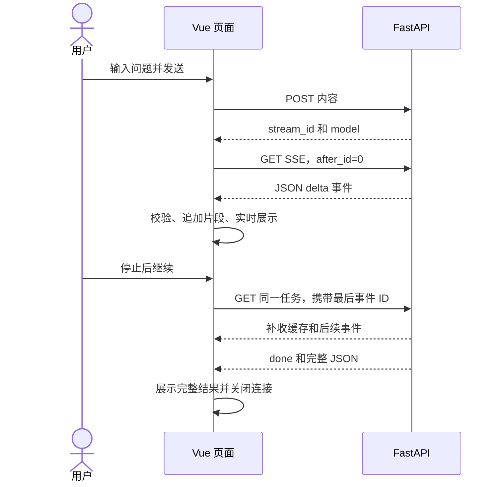

# 前端核心代码与流程说明

前端使用 Vue 3，提交用户内容后订阅 DeepSeek 的实时输出，将多轮问题和回答追加到对话中，并支持持久化历史和模型上下文记忆。后端实现见[后端说明](backend-guide.md)。

## 1. 文件职责

| 文件 | 作用 |
| --- | --- |
| [frontend/src/main.js](../frontend/src/main.js) | 创建 Vue 应用，导入样式并挂载页面 |
| [frontend/src/App.vue](../frontend/src/App.vue) | 输入问题、发送/停止/继续按钮、内容对话与 JSON 视图 |
| [frontend/src/composables/useSseStream.js](../frontend/src/composables/useSseStream.js) | POST 创建任务、SSE 订阅、校验、续传、计时和连接清理 |
| [frontend/src/style.css](../frontend/src/style.css) | 桌面与手机布局、输出区和状态样式 |
| [frontend/vite.config.js](../frontend/vite.config.js) | 开发代理与生产构建位置 |
| [frontend/src/composables/useSseStream.test.js](../frontend/src/composables/useSseStream.test.js) | 模拟网络和连接生命周期的单元测试 |
| [frontend/src/utils/streamingJson.js](../frontend/src/utils/streamingJson.js) | 从尚未生成完整的 JSON 中提取、解码顶层 `answer` 字符串 |

## 2. 为什么分成 POST 与 SSE 两步

浏览器原生 `EventSource` 使用 GET，不适合携带 JSON 请求体。页面先用 `fetch` 提交问题，拿到后端任务 ID，再用 `EventSource` 订阅任务结果。问题放在 POST 请求体中，不出现在订阅 URL 中。

```javascript
const response = await fetch('/api/sse/generations', {
  method: 'POST',
  headers: { 'Content-Type': 'application/json' },
  body: JSON.stringify({ content: text }),
  signal: controller.signal,
})
```

后端返回 `stream_id`、`model`。前端验证任务 ID 为 32 位十六进制字符串后建立连接：

```javascript
const query = new URLSearchParams({
  stream_id: streamId.value,
  after_id: String(lastEventId.value),
})
const connection = new EventSource(`/api/sse/jsonlines?${query}`)
```

密钥始终由后端持有，前端请求只包含用户内容、任务 ID 与事件游标。

## 3. 核心状态

| 状态 | 作用 |
| --- | --- |
| `records` | 已收到的片段，每条包含 `data` 和浏览器接收时间 `receivedAt` |
| `submittedContent` | 本轮已提交的问题快照，修改输入框不会改变它 |
| `turns` | 当前对话全部问答，追加新消息时保留已有内容 |
| `conversationId`、`activeTurnId` | 当前对话与正在展示的这轮问答 ID |
| `conversations` | 后端已保存的历史对话列表 |
| `historyLoading`、`historyError` | 读取历史的状态与错误提示 |
| `rawJson` | 将全部片段的 `content` 按顺序拼接，得到实时 JSON 文本 |
| `result` | 后端完成解析和校验后返回的完整 JSON 对象 |
| `streamId` | 当前任务 ID，继续接收时复用 |
| `lastEventId` | 最后处理成功的 SSE 事件 ID，续传起点 |
| `model`、`usage` | 后端模型标识及上游返回的 token 用量 |
| `status`、`error` | 生命周期状态和可展示的错误 |
| `elapsed` | 累计连接耗时，不包含手动停止期间的时间 |
| `requestUrl` | 最近一次订阅地址，用于页面底部展示 |
| `isActive` | 正在提交或接收，禁用重复发送与新建对话 |
| `canResume` | 已手动停止且已有任务 ID，显示继续按钮 |

完整问答由后端保存到本地 MySQL 的 `deepseek_chat` 库；浏览器 localStorage 只记录上次选择的对话 ID。`App.vue` 挂载后调用 `initialize()` 读取历史列表，再用 `selectConversation()` 恢复全部问答。输入框只影响下一条消息；停止后继续仍订阅原任务。数据库切换不影响前端接口，迁移时保留原对话 ID，因此原有选择仍可恢复。

## 4. 开始发送的流程

表单通过 `@submit.prevent="start(content)"` 触发组合函数，阻止默认表单刷新。

1. `start()` 检查当前没有活跃连接，并验证去空白后的输入非空、长度不超过 8000。
2. 保留 `turns`，先追加本轮问题与等待中的回答，再重置本轮 JSON 事件、结果、用量、任务 ID、游标和耗时。
3. `begin()` 清理旧连接，将状态设为 `connecting`，启动耗时刷新。
4. 使用 `AbortController` 创建可取消的 POST 请求。
5. 校验 HTTP 状态与返回的任务信息，保存 `streamId`、`model`、`conversation_id`、`turn_id`；后续 POST 携带同一 `conversation_id`，由后端补充历史上下文。
6. 调用 `connect()` 订阅 SSE；连接打开后进入 `streaming`。

`version` 是本轮操作编号。异步 POST 返回时先检查编号，用户已经停止或切换到新对话时，旧请求的结果不会创建新订阅。

## 5. 三类 JSON 事件如何处理

### 普通消息：`message`

后端发送完整的 JSON 包装对象：

```json
{"type":"delta","index":1,"content":"{\"answer\":"}
```

`readEvent()` 先检查 SSE 的 `lastEventId` 恰好为上一事件 ID 加 1，再解析 `event.data`。普通消息还要满足：`type` 为 `delta`、`index` 恰好为已收片段数加 1、`content` 为字符串。

通过校验后追加到 `records`，并更新游标。`rawJson` 自动重新拼接文本，Vue 更新输出区和片段数。一个片段的 `content` 可以只有几个字符，只有完整输出才可作为最终 JSON 解析。

### 完成消息：`done`

```json
{"type":"done","count":2,"result":{"answer":"回答内容"},"model":"deepseek-v4-pro","usage":{"total_tokens":100}}
```

前端确认总片段数与已收到的记录一致，`result` 是包含字符串 `answer` 的对象，再保存完整结果与用量，执行 `finish('completed')`。

右侧默认显示「内容对话」：通过 `v-for="turn in turns"` 展示每轮独立的用户气泡与模型气泡。用户气泡使用已提交的 `turn.content`，模型气泡读取该轮 `turn.raw_json` 的部分 `answer`；完成后使用持久化结果 `turn.result.answer`。新消息不会覆盖之前的气泡。

流式提取器会跳过其他字段和嵌套字符串，将 `\\n`、`\\"`、Unicode 转义等恢复为正文；片段末尾不完整的转义序列留待后续补齐。JSON 包装字符不会出现在对话正文中。模型回答按纯文本保留换行，Markdown 标记也按文本展示。

「实时输出 / 完整 JSON」显示拼接中的原始 JSON，完成后使用 `JSON.stringify(result, null, 2)` 显示带缩进的对象。「JSON 事件」逐条展示 `JSON.stringify(record.data)` 和接收时间。切换视图只影响展示，所有内容使用 Vue 文本插值渲染。

### 错误消息：`failure`

```json
{"type":"error","message":"DeepSeek 账户余额不足，请充值后重试。"}
```

前端展示后端整理的错误说明，保留已有片段、关闭连接并进入 `error`。浏览器订阅失败或任务过期时使用通用连接提示；POST 参数和配置错误优先展示后端 `detail`。

## 6. 停止与继续接收

停止调用 `finish('stopped')`：更新耗时、关闭 `EventSource`、取消尚未完成的 POST、停止计时器。已有片段和任务 ID 保留。

继续调用 `resume()`：沿用当前 `streamId` 和 `lastEventId`，创建新的 GET 订阅，不再发送创建任务的 POST，因此不重复调用 DeepSeek。

例如已经处理事件 12：

```text
GET /api/sse/jsonlines?stream_id=原任务ID&after_id=12
```

后端从缓存中的事件 13 开始发送，然后等待新的模型输出。停止期间模型仍继续生成，因此也可能在继续后立即补收全部缓存及 `done`。

若停止时 POST 响应尚未到达，前端还没有任务 ID，无法继续该任务；后端有可能已经开始生成。可刷新历史列表查找已创建的对话。手动停止后应先继续接收本轮结果，再发送下一条，避免同一对话中出现并发生成。

`begin()` 保存之前的耗时并重新设置计时起点：

```javascript
elapsedBeforeConnection = elapsed.value
startedAt = performance.now()
// 更新时
elapsed.value = elapsedBeforeConnection + (performance.now() - startedAt) / 1000
```

暂停期间无活跃计时器，继续后只加上新连接的时间。

## 7. 生命周期与防止旧回调污染

| 操作或事件 | 状态变化 |
| --- | --- |
| 发送消息 | `connecting`，追加新问答，保留此前全部问答；仅重置当前 JSON 事件视图 |
| SSE 打开 | `streaming` |
| 停止 | `stopped` |
| 继续 | `connecting`，复用任务和游标 |
| 合法 `done` | `completed` |
| POST、网络、数据或模型失败 | `error`，保留片段供查看 |
| 新建对话（组合函数中的 `clear()`） | `idle`，打开独立对话，不删除后端已保存的历史 |

回调同时检查操作编号和连接对象：

```javascript
const isCurrent = () => ticket === version && source === connection
```

旧连接即使迟到触发回调，也不能追加重复数据或覆盖新状态。完成和错误时主动 `close()`，避免 `EventSource` 自动重连；组件卸载时取消 POST、关闭 SSE、释放计时器。

## 8. 展示与完整流程

日志区通过监听记录长度，在 `nextTick()` 后滚动到底部。切换视图、获得最终结果或开启自动滚动时也会重新定位。模型输出片段数未知，页面显示接收数量与活动指示，不再使用模拟数据的条数和间隔参数。



## 9. 开发和测试

```bash
cd frontend
npm ci
npm test
npm run build
```

单元测试覆盖提交、完整结果、续传只调用一次 POST、排除暂停耗时、旧回调、上游错误、非法数据、取消待完成 POST 和服务错误；另有流式正文提取测试，覆盖逐字符到达、换行/引号/反斜线、Unicode 代理对和嵌套字段。

开发时运行 `npm run dev`，访问 <http://127.0.0.1:5173/>；后端需运行在 8000 端口。生产构建输出到 `src/fastapi_demo/static/`，由 FastAPI 同源提供访问。

## 10. 历史恢复与对话切换

`initialize()` 请求 `/api/sse/conversations`，优先选择 localStorage 中保存的 ID，没有匹配时恢复最近对话。`selectConversation()` 请求 `/api/sse/conversations/{id}`，把完整历史放入 `turns`，将最新一轮结果用于 JSON 视图。

若最新一轮仍在生成，页面使用原 `stream_id` 从事件 0 开始重新订阅，在新连接内重建当前片段记录，不调用新的模型任务。历史回答以数据库中的完整对象恢复；单个 SSE 网络事件只存在于任务缓存中。

「新建对话」清理当前页面的活动状态和已选 ID，下一次 POST 不带 `conversation_id`，后端创建独立上下文。旧对话继续保存在历史列表里。

每轮回答的 `context_count` 显示实际参考的历史轮数。模型记忆来自后端传入的历史消息，并非只在界面上展示旧内容。测试同时验证多轮追加、对话 ID 复用、历史恢复和新对话隔离。
