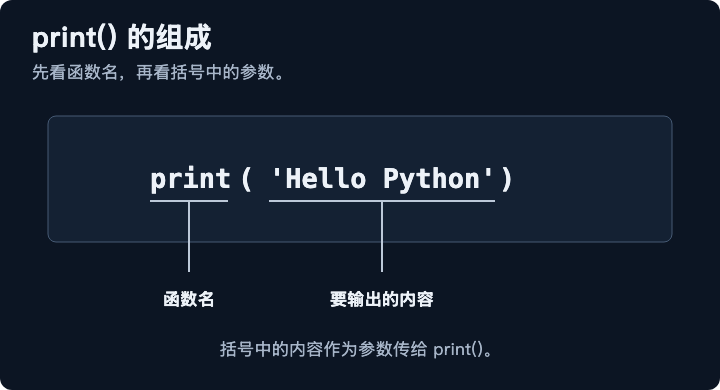
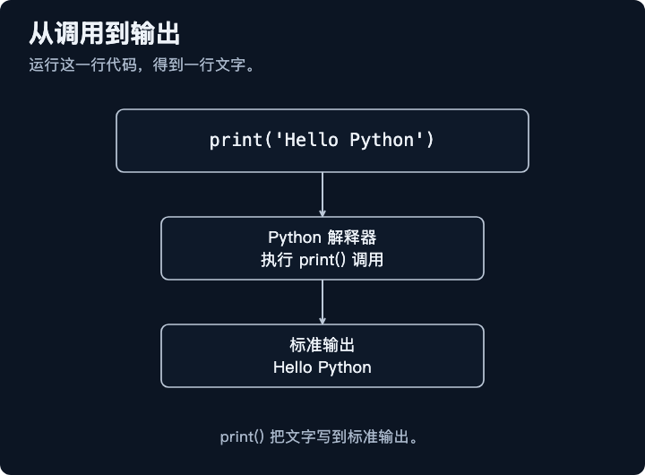
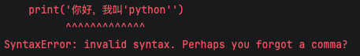

## 输入与输出(input、print)

- input语句的功能就是获取键盘输入的数据，具体的用法为：s = input(提示信息)
- print语句的功能就是将数据输出到控制台，具体语法为：print(数据...)



它的执行流程如下：
- 向解释器发出指令，打印 'Hello Python'
- 解析器把代码解释为计算器能读懂的机器语言
- 计算机执行完后就打印结果



### print语法

```python
print(*objects, sep=" ", end="\n", file=None, flush=False)
```

| 参数 | 作用 | 默认值 |
| --- | --- | --- |
| `*objects` | 要输出的一个或多个对象 | 无 |
| `sep` | 多个对象之间的分隔符 | 空格 `" "` |
| `end` | 输出结束时添加的内容 | 换行符 `"\n"` |
| `file` | 输出目标，例如文件对象 | `None`，表示控制台 |
| `flush` | 是否立即刷新输出缓冲区 | `False` |

####  sep设置分隔符

```python
print("2026", "11", "01", sep="-") # 2026-11-01
```

#### end设置结尾内容
```python
print("Hello", end=" ")
print("Python")

# 输出内容： Hello Python
```

## 字面量

指程序中，直接书写的固定值(数据)，就成为字面量。


| 类型分类 | 数据类型 | 说明 | 示例 |
| --- | --- | --- | --- |
| 数字类型 | 整数（`int`） |  | `10`、`18`、`-5`、`0` |
| 数字类型 | 浮点数/小数（`float`） |  | `8.5`、`3.14`、`1.0`、`-3.5` |
| 布尔（`bool`） |  | 表达现实生活中的逻辑，真或假 | `True`、`False` |
| 字符串（`str`） |  | 描述文本的一种数据类型 | `"人生苦短，我用Python"` |
| 空值（`NoneType`） |  | 表示空或无值，仅包含一个值 `None` | `None` |
| 数据容器 |  | 存储多项数据的容器 | 列表 / 元组 / 集合 / 字典 |

## 变量

变量：程序中用来存储单个数据的容器，通常会把经常发生变化的数据存储在变量中。

定义格式：`变量名 = 变量的值`

注意： Python是动态类型语言，在程序运行时才进行类型检查，变量的类型可以在程序运行过程中改变（一个变量可以接收不同类型的值）

```python
name = "小明"
age = 18
score = 95.5
is_student = True
```

变量实际上是指向对象的名称：

```python
value = 10
print(type(value))  # <class 'int'>

value = "Python"
print(type(value))  # <class 'str'>
```

变量的命名规则： 
- 只能包含字母(a-z A-Z)、数字(0-9)和下划线(_)。
- 不能以数字开头
- 不能使用Python关键字(True、False、None、and、or、if、else、elif、for、while等)
- 区分大小写(age,Age,AGE是三个变量)
- 推荐使用小写加下划线(user_name)

变量的命名规范：
- 见名知意
- 多个部分使用下划线链接
- 英文字母全小写

>PEP8: https://peps.python.org/pep-0008/


## 基本数据类型

| 类型 | 示例 | 说明 |
| --- | --- | --- |
| `int` | `18` | 整数 |
| `float` | `3.14` | 浮点数 |
| `complex` | `2 + 3j` | 复数 |
| `bool` | `True`、`False` | 布尔值 |
| `str` | `"Python"` | 字符串 |
| `list` | `[1, 2, 3]` | 列表，可修改 |
| `tuple` | `(1, 2, 3)` | 元组，通常不可修改 |
| `dict` | `{"name": "小明"}` | 字典，键值对集合 |
| `set` | `{1, 2, 3}` | 集合，元素不重复 |
| `NoneType` | `None` | 表示没有值 |
| `bytes` | `b"hello"` | 二进制数据 |

## 常用内置数据类型

| 类型         | 示例值 `x`           | `type(x)` 结果         | 判断表达式                  | 判断结果 |
| ------------ | -------------------- | ---------------------- | --------------------------- | -------- |
| `NoneType`   | `None`               | `<class 'NoneType'>`   | `isinstance(x, type(None))` | `True`   |
| `bool`       | `True`               | `<class 'bool'>`       | `isinstance(x, bool)`       | `True`   |
| `int`        | `42`                 | `<class 'int'>`        | `isinstance(x, int)`        | `True`   |
| `float`      | `3.14`               | `<class 'float'>`      | `isinstance(x, float)`      | `True`   |
| `complex`    | `2 + 3j`             | `<class 'complex'>`    | `isinstance(x, complex)`    | `True`   |
| `str`        | `"Python"`           | `<class 'str'>`        | `isinstance(x, str)`        | `True`   |
| `list`       | `[1, 2, 3]`          | `<class 'list'>`       | `isinstance(x, list)`       | `True`   |
| `tuple`      | `(1, 2, 3)`          | `<class 'tuple'>`      | `isinstance(x, tuple)`      | `True`   |
| `range`      | `range(5)`           | `<class 'range'>`      | `isinstance(x, range)`      | `True`   |
| `dict`       | `{"name": "小明"}`   | `<class 'dict'>`       | `isinstance(x, dict)`       | `True`   |
| `set`        | `{1, 2, 3}`          | `<class 'set'>`        | `isinstance(x, set)`        | `True`   |
| `frozenset`  | `frozenset({1, 2})`  | `<class 'frozenset'>`  | `isinstance(x, frozenset)`  | `True`   |
| `bytes`      | `b"abc"`             | `<class 'bytes'>`      | `isinstance(x, bytes)`      | `True`   |
| `bytearray`  | `bytearray(b"abc")`  | `<class 'bytearray'>`  | `isinstance(x, bytearray)`  | `True`   |
| `memoryview` | `memoryview(b"abc")` | `<class 'memoryview'>` | `isinstance(x, memoryview)` | `True`   |
| `slice`      | `slice(1, 5)`        | `<class 'slice'>`      | `isinstance(x, slice)`      | `True`   |

自定义类示例:

```python
class Animal:
    pass

class Dog(Animal):
    pass

dog = Dog()

print(type(dog))                 # <class '__main__.Dog'>
print(isinstance(dog, Dog))      # True
print(isinstance(dog, Animal))   # True
```

## 容易混淆的判断结果

| 判断代码                       |    结果 | 原因                           |
| ------------------------------ | ------: | ------------------------------ |
| `type(True) is bool`           |  `True` | `True` 的实际类型是 `bool`     |
| `type(True) is int`            | `False` | `bool` 不是 `int` 的精确类型   |
| `isinstance(True, int)`        |  `True` | `bool` 是 `int` 的子类         |
| `isinstance(3, (int, float))`  |  `True` | `3` 属于多个候选类型中的 `int` |
| `isinstance("3", int)`         | `False` | `"3"` 是字符串，不是整数       |
| `isinstance(None, type(None))` |  `True` | `None` 的类型是 `NoneType`     |
| `isinstance([1, 2], list)`     |  `True` | 列表属于 `list`                |
| `isinstance([1, 2], tuple)`    | `False` | 列表不属于元组                 |
| `type([1, 2]) is list`         |  `True` | 实际类型正是 `list`            |
| `type(True) == int`            | `False` | `type(True)` 返回 `bool`       |
| `issubclass(bool, int)`        |  `True` | `bool` 继承自 `int`            |

## type() 的精确判断与 isinstance() 的继承判断

```python
class MyList(list):
    pass

items = MyList([1, 2, 3])

print(type(items) is list)
# False，因为实际类型是 MyList

print(isinstance(items, list))
# True，因为 MyList 是 list 的子类
```

可以这样理解：

| 情况              | `type(x) is list` | `isinstance(x, list)` |
| ----------------- | ----------------: | --------------------: |
| 普通列表 `[1, 2]` |            `True` |                `True` |
| `list` 子类对象   |           `False` |                `True` |
| 元组 `(1, 2)`     |           `False` |               `False` |

## 最常用的类型判断速记表

| 目的                 | 写法                          |
| -------------------- | ----------------------------- |
| 查看实际类型         | `type(x)`                     |
| 查看类型名称         | `type(x).__name__`            |
| 精确判断类型         | `type(x) is int`              |
| 判断类型或子类       | `isinstance(x, int)`          |
| 判断多个类型         | `isinstance(x, (int, float))` |
| 判断是否为空         | `x is None`                   |
| 判断是否为类         | `isinstance(x, type)`         |
| 判断是否可调用       | `callable(x)`                 |
| 判断类之间的继承关系 | `issubclass(Dog, Animal)`     |

## 常见运行时对象类型

```python
import math
import types
from collections.abc import Iterator
```

| 对象类型     | 示例                    | `type(x)` 结果                 | 判断表达式                            | 结果   |
| ------------ | ----------------------- | ------------------------------ | ------------------------------------- | ------ |
| 函数         | `lambda: None`          | `<class 'function'>`           | `isinstance(x, types.FunctionType)`   | `True` |
| 生成器       | `(i for i in range(3))` | `<class 'generator'>`          | `isinstance(x, types.GeneratorType)`  | `True` |
| 迭代器       | `iter([1, 2])`          | `<class 'list_iterator'>`      | `isinstance(x, Iterator)`             | `True` |
| 模块         | `math`                  | `<class 'module'>`             | `isinstance(x, types.ModuleType)`     | `True` |
| 异常对象     | `ValueError("错误")`    | `<class 'ValueError'>`         | `isinstance(x, Exception)`            | `True` |
| 类对象       | `Dog`                   | `<class 'type'>`               | `isinstance(x, type)`                 | `True` |
| 自定义类实例 | `Dog()`                 | `<class '__main__.Dog'>`       | `isinstance(x, Dog)`                  | `True` |
| 省略号       | `...`                   | `<class 'ellipsis'>`           | `isinstance(x, type(...))`            | `True` |
| 未实现标记   | `NotImplemented`        | `<class 'NotImplementedType'>` | `isinstance(x, type(NotImplemented))` | `True` |

##  查看数据类型
```python
age = 18

print(type(age))              # <class 'int'>
print(isinstance(age, int))   # True
```

| 写法                      | 作用                       | 示例                           | 结果            |
| ------------------------- | -------------------------- | ------------------------------ | --------------- |
| `type(x)`                 | 返回对象的实际类型         | `type(10)`                     | `<class 'int'>` |
| `type(x).__name__`        | 返回类型名称字符串         | `type(10).__name__`            | `'int'`         |
| `type(x) is T`            | 判断是否为完全相同的类型   | `type(10) is int`              | `True`          |
| `isinstance(x, T)`        | 判断是否属于某类型或其子类 | `isinstance(10, int)`          | `True`          |
| `isinstance(x, (T1, T2))` | 同时判断多个类型           | `isinstance(10, (int, float))` | `True`          |

- 只想查看精确类型：使用 type(x)。
- 想判断对象能否按某种类型使用：优先使用 isinstance(x, T)。
- 判断 None：推荐使用 x is None。

## 类型转换

```python
age = int("18")
price = float("3.14")
text = str(100)
result = bool(1)

print(age)    # 18
print(price)  # 3.14
print(text)   # "100"
print(result) # True
```

## 字符串

字符串的三种定义方式：

```python
# 双引号定义
s1 = "Hello"

# 单引号定义
s2 = 'Python'

# 三引号定义(多行字符串)
s3 = """
    尊敬的客户：
        感谢您选择我们的产品。
        我们会提供最好的服务。
"""
```

为什么会有单引号、双引号、三引号？

如果我们的字符串是这样的：'你好，我叫'python''。

```python
print('你好，我叫'python'')
```



所以双引号是不行，我们可以用这样做：

```python
print("你好，我叫'python'")
print('你好，我叫\'python\'')
print(''' 你好，我叫'python' ''')
```

常见的转义字符

| 转义字符 | 名称 | 作用 |
| --- | --- | --- |
| `\'` | 单引号 | 表示单引号 `'` |
| `\"` | 双引号 | 表示双引号 `"` |
| `\n` | 换行符 | 开始新的一行（换行） |
| `\t` | 制表符 | 增加缩进，缩进一个制表符（Tab）的大小 |

### f-string(把变量嵌进字符串)

`Python` 最推荐的写法叫 `f-string`（`Python 3.6+` 引入）：在字符串的引号前面加一个 `f`，字符串里用 `{}` 包住变量名，`Python` 就会把 `{}` 换成变量的值。

```python
name = 'along'

print(f'我叫{name}')
```

#### self-documenting：调试的神器 f"{x=}"

```python
name = '两点水'
age = 18
print(f'name={name}, age={age}')
```

输出结果

```python
name=两点水, age=18
```
变量名要自己写两遍，一改名就容易漏。从 Python 3.8 开始，f-string 提供了一个 = 语法（self-documenting expressions），可以一步到位：


```python
name = '两点水'
age = 18

print(f'{name=}, {age=}') # 输出结果： name='两点水', age=18
```

```python
# 能直接放表达式
a = 3
b = 4

print(f'{a + b = }')  # 输出结果： a + b = 7
```


### 格式说明：对齐、保留小数、千分位

f-string 的大括号里，冒号 : 后面可以跟「格式说明」，控制输出的样子。

```python
# 保留两位小数

pi = 3.1415926
print(f'{pi:.2f}')  # 输出结果： 3.14
```

```python
# 右对齐、占 10 个字符宽。 > 是右对齐， < 是左对齐， ^ 是居中

name = '两点水'
print(f'[{name:>10}]') # 输出结果： [       两点水]
```

```python
# 数字加千分位逗号

amount = 1234567890
print(f'订单金额：{amount:,} 元') # 输出结果：订单金额：1,234,567,890 元
```


```python
# 百分号格式：

rate = 0.875
print(f'转化率：{rate:.1%}') # 输出结果： 转化率：87.5%
```

```python
#  Python 3.12+ ：嵌套引号不再受限

data = {'name': '两点水', 'age': 18}
# Python 3.12+ 才允许：内外都用单引号
print(f'昵称是 {data['name']}') # 输出结果：昵称是 两点水
```

## Python3 运算符

| 类型       | 常见运算符                    | 示例                     |         |
| ---------- | ----------------------------- | ------------------------ | ------- |
| 算术运算符 | `+` `-` `*` `/` `//` `%` `**` | `10 % 3`                 |
| 赋值运算符 | `=` `+=` `-=` `*=` `/=`       | `x += 1`                 |
| 比较运算符 | `==` `!=` `>` `<` `>=` `<=`   | `a == b`                 |
| 逻辑运算符 | `and` `or` `not`              | `age >= 18 and age < 60` |
| 位运算符   | `&` `                         | ` `^` `~` `<<` `>>`      | `5 & 3` |
| 成员运算符 | `in` `not in`                 | `"a" in "cat"`           |
| 身份运算符 | `is` `is not`                 | `x is None`              |

### Python算术运算符

| 运算符 | 作用     | 示例      | 结果       |
| ------ | -------- | --------- | ---------- |
| `+`    | 加法     | `10 + 3`  | `13`       |
| `-`    | 减法     | `10 - 3`  | `7`        |
| `*`    | 乘法     | `10 * 3`  | `30`       |
| `/`    | 普通除法 | `10 / 3`  | `3.333...` |
| `//`   | 整除     | `10 // 3` | `3`        |
| `%`    | 取余数   | `10 % 3`  | `1`        |
| `**`   | 幂运算   | `10 ** 3` | `1000`     |


### 赋值运算符

赋值运算符用于把数据保存到变量中。

```python
age = 18
```

这里的`=`表示把右边的值赋给左边的变量，不是`等于`

### 复合赋值

| 运算符 | 示例      | 等价写法     |
| ------ | --------- | ------------ |
| `+=`   | `x += 2`  | `x = x + 2`  |
| `-=`   | `x -= 2`  | `x = x - 2`  |
| `*=`   | `x *= 2`  | `x = x * 2`  |
| `/=`   | `x /= 2`  | `x = x / 2`  |
| `//=`  | `x //= 2` | `x = x // 2` |
| `%=`   | `x %= 2`  | `x = x % 2`  |
| `**=`  | `x **= 2` | `x = x ** 2` |

### 比较运算符

比较运算符用于比较两个数据，结果通常是布尔值`True`或者`False`。

| 运算符 | 作用       | 示例           |
| ------ | ---------- | -------------- |
| `==`   | 等于       | `10 == 10`     |
| `!=`   | 不等于     | `10 != 5`      |
| `>`    | 大于       | `10 > 5`       |
| `<`    | 小于       | `10 < 5`       |
| `>=`   | 大于或等于 | `age >= 18`    |
| `<=`   | 小于或等于 | `score <= 100` |

### 逻辑运算符

逻辑运算符用于组合多个条件。

| 运算符 | 作用   | 说明                     |
| ------ | ------ | ------------------------ |
| `and`  | 逻辑与 | 两边都成立，结果才成立   |
| `or`   | 逻辑或 | 至少一边成立，结果就成立 |
| `not`  | 逻辑非 | 对结果取反               |

> 常见的假值包括：False、None、0、""、[]、{}


#### 短路运算

`and`左边为假时，右边不再执行；`or`左边为真时，右边不再执行。

### 成员运算符

成员运算符用于判断某个数据是否存在于字符串、列表、元组等容器中。

| 运算符   | 作用           |
| -------- | -------------- |
| `in`     | 判断是否存在   |
| `not in` | 判断是否不存在 |

```python
fruits = ["苹果", "香蕉", "橙子"]

print("苹果" in fruits)       # True
print("西瓜" not in fruits)   # True
```

### 身份运算符

身份运算符用于判断两个变量是否指向同一个对象

| 运算符   | 作用               |
| -------- | ------------------ |
| `is`     | 是否为同一个对象   |
| `is not` | 是否不是同一个对象 |

```python
result = None

print(result is None)      # True
print(result is not None)  # False
```

#### `==`和`is`的区别

- ==：比较两个对象的值是否相等
- 比较两个变量是否指向同一个对象

```python
a = [1, 2]
b = [1, 2]

print(a == b)  # True，内容相等
print(a is b)  # False，不是同一个列表
```

### 位运算符

位运算符直接对整数的二进制位进行运算

| 运算符 | 名称 | 作用 | 示例 | 结果 |
| --- | --- | --- | --- | ---: |
| `&` | 按位与 | 两个位都为 `1` 时，结果才为 `1` | `5 & 3` | `1` |
| `\|` | 按位或 | 只要有一个位为 `1`，结果就是 `1` | `5 \| 3` | `7` |
| `^` | 按位异或 | 两个位不相同时为 `1`，相同时为 `0` | `5 ^ 3` | `6` |
| `~` | 按位取反 | 将每一位 `0` 和 `1` 互换 | `~5` | `-6` |
| `<<` | 左移 | 二进制向左移动，右侧补 `0` | `5 << 1` | `10` |
| `>>` | 右移 | 二进制向右移动，正数左侧补 `0` | `5 >> 1` | `2` |

```python
print(5 & 3)  # 1


5 = 101
3 = 011
& = 001

# 所以结果是 1。
```

### 条件表达式

条件表达式可以根据条件选择不同的值。

```sh
条件成立时的值 if 条件 else 条件不成立时的值
```

```python
age = 20

result = "成年" if age >= 18 else "未成年"
print(result)  # 成年
```

### 运算符的优先级

1、括号：()  
2、幂运算：\*\*  
3、正负号：+x、-x  
4、乘除：\*、/、//、%  
5、加减：+、-  
6、比较：==、!=、>、<、>=、<=  
7、not  
8、and  
9、or

### 常见问题

1、混淆赋值与比较

```python
# 错误
if age = 18:
    print("年龄是18岁")

#正确
if age == 18:
    print("年龄是18岁")
```

2、字符串不能直接与整数相加

```python
# 错误
age = 18
print("年龄：" + age)

# 正确
print("年龄：" + str(age))

# 或者使用f-string
print(f"年龄：{age}")
```

3、整除不能为0

```python
# 错误
print(10 / 0)  # ZeroDivisionError

# 正确
number = 0

if number != 0:
    print(10 / number)
```

4、小数点可能存在精度问题

```python
print(0.1 + 0.2)  # 0.30000000000000004
```
## 浮点数

浮点数的英文名是 float ，是指带小数的数字。这是因为计算机对浮点数的表达本身是不精确的。保存在计算机中的是二进制数，二进制对有些数字不能准确表达，只能非常接近这个数。

