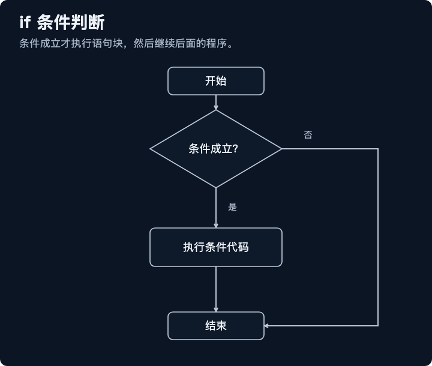
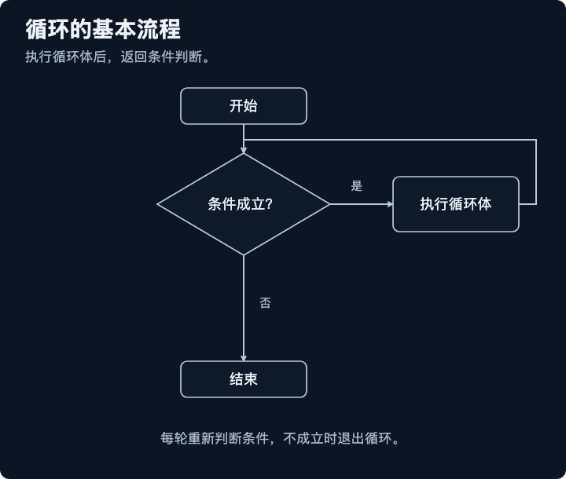
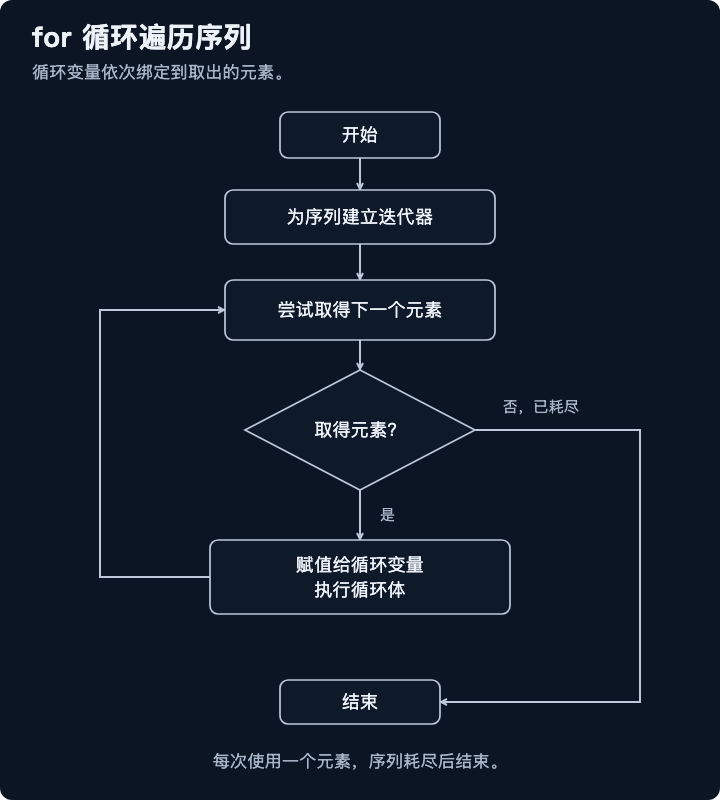
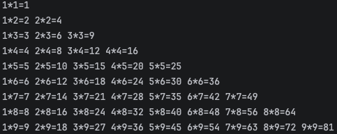

## 条件判断

### if条件判断
只有满足指定条件，才会执行对应的代码逻辑。



### if语句的基本形式

```python
if 判断条件：
    执行语句……
else：
    执行语句……
```
> if 语句的判断条件可以用>（大于）、<(小于)、==（等于）、>=（大于等于）、<=（小于等于）来表示其关系。

案例：如果我高考分数超过680，我就去清华读书。

```python
score = 695

if score > 680:
    print('欢迎你，来清华读书')
```

### if语句多个判断条件的形式

```python
results = 89

if results > 90:
    print('优秀')
elif results > 80:
    print('良好')
elif results > 60:
    print ('及格')
else :
    print ('不及格')
```


### if 语句多个条件同时判断

```python
java = 86
python = 68

if java > 80 and  python > 80:
    print('优秀')
else :
    print('不优秀')

if ( java >= 80  and java < 90 )  or ( python >= 80 and python < 90):
    print('良好')
```

### if嵌套

```python
java = 86
python = 68

if java > 80:
    if python > 80:
        print('优秀')
    else:
        print('不优秀')
else:
    print('不优秀')
```

## 模式匹配

###  Python 3.10+ 的新写法：match / case

我们先看一个需求，假设水哥想根据后台返回的「指令字符串」来做不同的事情：

```python
command = 'start'

if command == 'start':
    print('启动')
elif command == 'stop':
    print('停止')
elif command == 'pause':
    print('暂停')
else:
    print('未知指令')
```
这样写没毛病，但是当分支多起来的时候，一长串 elif 就显得啰嗦了。我们用 match / case 重写一下：

```python
command = 'start'

match command:
    case 'start':
        print('启动')
    case 'stop':
        print('停止')
    case 'pause':
        print('暂停')
    case _:
        print('未知指令')
```
这里的 case _ 就是兜底分支，相当于 else，下划线 _ 是个通配符，匹配任何还没被前面 case 命中的情况.

`match` / `case` 真正的厉害之处，是它能匹配「结构」，不仅仅是「值」.

来看一个序列匹配的例子，假设产品反馈过来一个坐标数据：

```python
point = [10, 20]

match point:
    case [0, 0]:
        print('原点')
    case [x, 0]:
        print(f'在 x 轴上，x = {x}')
    case [0, y]:
        print(f'在 y 轴上，y = {y}')
    case [x, y]:
        print(f'普通点，x = {x}，y = {y}')
    case _:
        print('不是二维坐标')

# 普通点，x = 10，y = 20
```

match / case 也能匹配字典的「形状」：

```python
response = {'status': 'ok', 'data': [1, 2, 3]}

match response:
    case {'status': 'ok', 'data': data}:
        print(f'成功，拿到数据 {data}')
    case {'status': 'error', 'message': msg}:
        print(f'失败：{msg}')
    case _:
        print('未知响应')

# 成功，拿到数据 [1, 2, 3]
```

match / case 还能跟「类」一起用，配合 dataclass 食用，效果更佳：
```python
from dataclasses import dataclass


@dataclass
class Point:
    x: int
    y: int


p = Point(0, 5)

match p:
    case Point(x=0, y=0):
        print('原点')
    case Point(x=0, y=y):
        print(f'在 y 轴上，y = {y}')
    case Point(x=x, y=0):
        print(f'在 x 轴上，x = {x}')
    case Point(x=x, y=y):
        print(f'普通点 ({x}, {y})')
# 在 y 轴上，y = 5
```

再介绍一个小特性，叫「守卫条件」（guard），就是在 case 后面加一个 if：

```python
score = 75

match score:
    case x if x >= 90:
        print('优秀')
    case x if x >= 80:
        print('良好')
    case x if x >= 60:
        print('及格')
    case _:
        print('不及格')
# 及格
```

## 循环



### while

while循环的语法结构：

```python
while 条件表达式:
    循环体语句1
    循环体语句2
    ...

while 条件表达式:
    循环体语句1
    循环体语句2
    ...
else:
    条件为False，循环体正常结束时执行，可以省略不写
```
我们先来看看 While 循环语句的例子,计算 1 到 100 所有整数的和。

```python
count = 1
sum1 = 0

while count <= 100:    # 条件语句
    sum1 = sum1 + count    # while 子句
    count = count + 1

print(sum1) # 5050
```

### for循环语句


for循环的语法格式：

```python
for 元素 in 待处理的数据集:
    循环体代码
else:
    循环结束时，执行的代码
```


### for 循环和 whlie 循环的区别
while循环是通过条件表达式来控制是否要进行下一次循环的。而for循环，本质上是一种轮训🏪机制，对一批内容进行逐个处理。

### 退出循环

| 循环控制语句 | 描述 |
| --- | --- |
| `break` | 在语句块执行过程中终止循环，并跳出整个循环 |
| `continue` | 在语句块执行过程中终止当前循环，跳过本次循环，执行下一次循环 |
| `pass` | `pass` 是空语句，用于保持程序结构的完整性 |


###  for循环与while循环的场景
- while循环：用于在某个条件满足时一直循环，循环的次数通常是未知的，只知道循环开始/结束的条件。
- for循环：用于对一个已知的数据集进行遍历或已知次数的循环。

## range()函数

- 作用：生成指定规则的数字序列
- 用法1： `range(end)` -> 获取一个从0开始，到end结束的数字序列(不含end本身)
  - range(5)获取的数据是0,1,2,3,4
- 用法2：`range(start,end)` -> 获取一个从start开始，到end结束的数字序列(不含end本身)
  - range(2,8)获取的数据就是 2,3,4,5,6,7
- 用法3：`range(start,end.step)` -> 获取一个从start开始，到end结束的数字序列，step步长(不含end本身)
  - range(0,10,2)获取的数据就是 0,2,4,6,8


## 嵌套循环

```python
for 元素 in 待处理的数据集1:
    循环体代码1
    循环体代码2
    ...
    for 元素 in 待处理的数据集2:
        循环体代码1
        循环体代码2
        ...
```

案例：打印99乘法表

```python
for i in range(1, 10):
    for j in range(1, i + 1):
        print(str(j) + '*' + str(i) + '=' + f'{i*j}' , end=' ')
    print()
```
