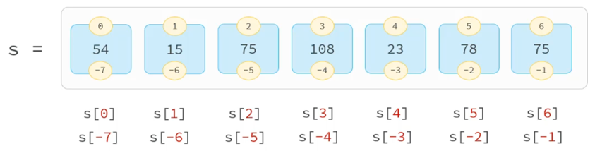
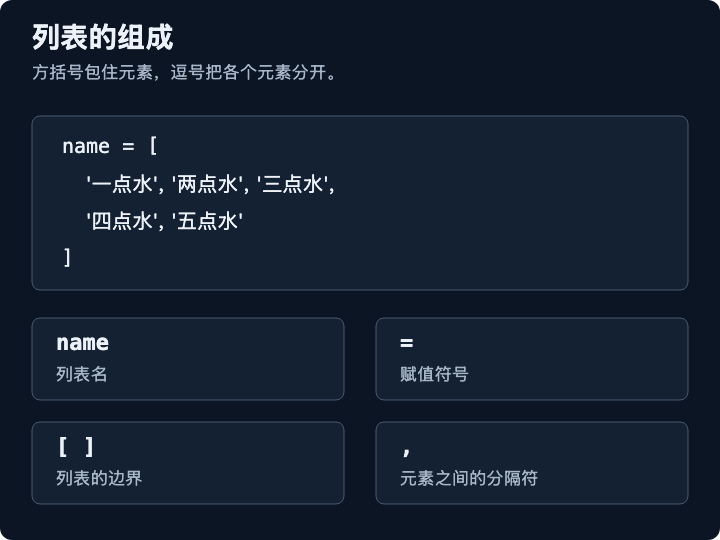
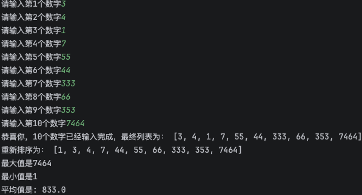
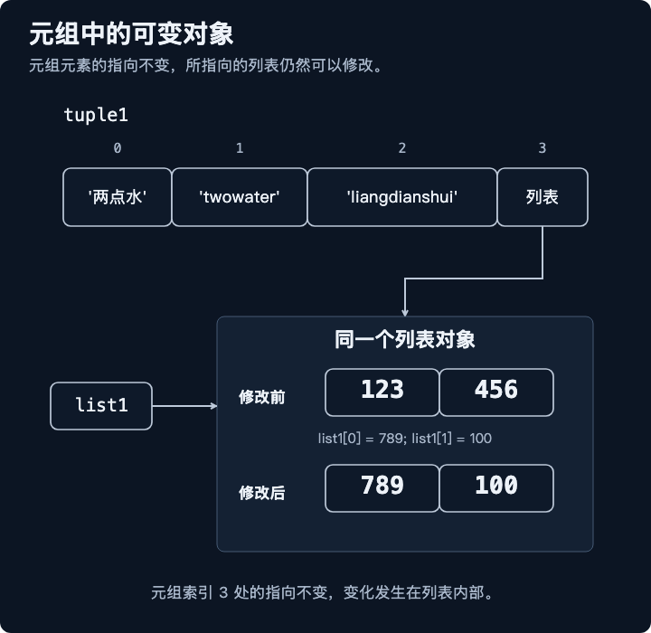

## 数据容器

一种可以容纳多分数据的数据类型(容器),容纳的每一份数据称之为1个元素，每一个元素都可以是任意类型的数据，如字符串、数字、布尔等。

## List

- 列表是数据容器中的一类，是一次性可以存储多个数据(元素)的。它是一种有序的集合，可以随时添加和删除其中的元素
- 定义： `列表名称 = [元素1，元素2，元素3...]` ， `s = [1,3,5,7,9]`
- 特点：
  - 可以储存不同类型的元素
  - 元素有序、可以重复、元素可以修改


### 怎么创建 List（列表）



其实列表就是用中括号 [] 括起来的数据，里面的每一个数据就叫做元素。每个元素之间使用逗号分隔。

```python
list1 = ['你好', 123, True, None]
```

### 如何访问 List（列表）中的值

```python
name = ['一点水', '两点水', '三点水', '四点水', '五点水']
```

#### 通过索引来获取

```python
# 正向索引获取
print(name[2]) # 三点水

#反向索引获取
print(name[-1]) # 五点水
```
 
#### 列表切片

- 介绍：切片是指对操作的数据截取其中一部分的操作。列表、字符串、元组都支持切片操作。

` s = ["A", "C", "E", "B", "D", "E", "G"]`

| 正向索引 | 0 | 1 | 2 | 3 | 4 | 5 | 6 |
| --- | --- | --- | --- | --- | --- | --- | --- |
| 元素 | `"A"` | `"C"` | `"E"` | `"B"` | `"D"` | `"E"` | `"G"` |
| 负向索引 | -7 | -6 | -5 | -4 | -3 | -2 | -1 |

- 语法：`序列数据[开始索引:结束索引:步长]`
  - 不包含结束索引位置对应的元素(开始索引未指定默认为0；结束索引未指定默认为列表长度(直到列表末尾);步长未指定默认为1)
  - 索引采用正向、反向索引都可以
  - 步长是选取间隔，默认步长为1

```python
print(s[0:2]) # ['A', 'C'] 
print(s[:2]) #  ['A', 'C'] 
print(s[:]) # ['A', 'C', 'E', 'B', 'D', 'E', 'G']
print(s[0:5:2]) # ['A', 'E', 'D']
```

### 怎么去更新 List（列表）

```python
name = ['一点水', '两点水', '三点水', '四点水', '五点水']

name[0] = '更新一点水'

print(name) # ['更新一点水', '两点水', '三点水', '四点水', '五点水']

name[5] = '更新一点水' # IndexError: list assignment index out of range
```

> 注意：如果指定的索引超出范围，将会报错 `list assignment index out of range`


### 怎么删除 List（列表）里面的元素

```python
name = ['一点水', '两点水', '三点水', '四点水', '五点水']

del name[0]

print(name)  #['两点水', '三点水', '四点水', '五点水']
```

### List（列表）运算符

列表对 `+` 和 `*` 的操作符与字符串相似。`+` 号用于组合列表，`*` 号用于重复列表。

| Python 表达式 | 结果 | 描述 |
| --- | --- | --- |
| `len([1, 2, 3])` | `3` | 计算元素个数 |
| `[1, 2, 3] + [4, 5, 6]` | `[1, 2, 3, 4, 5, 6]` | 组合 |
| `['Hi!'] * 4` | `['Hi!', 'Hi!', 'Hi!', 'Hi!']` | 复制 |
| `3 in [1, 2, 3]` | `True` | 元素是否存在于列表中 |
| `for x in [1, 2, 3]: print(x, end=" ")` | `1 2 3` | 迭代 |

#### 合并列表扩展
```python
s1 = [1,2,3,4,5,6]
s2 = [4,5,6,7,8,9]
```

```python
# 用加号运算符
s3 = s1 + s2 # [1, 2, 3, 4, 5, 6, 4, 5, 6, 7, 8, 9]

```

```python
# 使用*进行解包操作
s3 = [*s1, *s2] # [1, 2, 3, 4, 5, 6, 4, 5, 6, 7, 8, 9]
```


### List（列表）函数 & 方法

| 函数 & 方法 | 描述 |
| --- | --- |
| `len(list)` | 返回列表元素个数 |
| `max(list)` | 返回列表元素最大值 |
| `min(list)` | 返回列表元素最小值 |
| `list(seq)` | 将可迭代对象（如元组、字符串）转换为列表 |
| `list.append(obj)` | 在列表末尾添加一个对象 |
| `list.count(obj)` | 统计某个元素在列表中出现的次数 |
| `list.extend(seq)` | 将可迭代对象中的元素逐个追加到列表末尾 |
| `list.index(obj)` | 返回第一个匹配元素的索引 |
| `list.insert(index, obj)` | 在指定索引位置插入对象 |
| `list.pop()` / `list.pop(index)` | 移除并返回指定索引处的元素，默认移除最后一个元素 |
| `list.remove(obj)` | 移除第一个匹配的元素，返回 `None` |
| `list.reverse()` | 原地反转列表，返回 `None` |
| `list.sort(key=None, reverse=False)` | 原地排序列表，返回 `None` |


### 实例

- 将用户输入的10个数字，存储到一个列表中，并将列表中的数字进行排序，输出其中的最小值、最大值和平均值。

```python
num_list = []
sum1 = 0

while len(num_list) < 10:
    value = input(f'请输入第{len(num_list) + 1}个数字')
    num_list.append(int(value))
else:
    print('恭喜你，10个数字已经输入完成，最终列表为：', num_list)
    num_list.sort()
    print('重新排序为：', num_list)
    print(f'最大值是{max(num_list)}')
    print(f'最小值是{min(num_list)}')
    for i in num_list:
        sum1 += int(i)
    print(f'平均值是: {sum1 / len(num_list)}')
```
 

## 字符串

- 介绍：字符串是字符的容器，一个字符串中可以存放任意数量的字符。如："Python"、"123"
- 特点：不可变性(无法修改)、有序性、可迭代性。
- 字符串中的每一个字符元素都有其对应的下标(索引),通过元素对应的索引，就可以获取到对应的元素。

`s = "Python"`

| 正向索引 | 0 | 1 | 2 | 3 | 4 | 5 |
| --- | --- | --- | --- | --- | --- | --- |
| 字符 | `P` | `y` | `t` | `h` | `o` | `n` |
| 负向索引 | -6 | -5 | -4 | -3 | -2 | -1 |
| 正向访问 | `s[0]` | `s[1]` | `s[2]` | `s[3]` | `s[4]` | `s[5]` |
| 负向访问 | `s[-6]` | `s[-5]` | `s[-4]` | `s[-3]` | `s[-2]` | `s[-1]` |

> 注意：从前向后(正向索引),下标从0开始；从后向前(反向索引),下标从-1开始。

#### 字符串切片

介绍：切片是指对操作的数据截取其中一部分的操作。列表、字符串、元组都支持切片操作。

| 正向索引 | 0 | 1 | 2 | 3 | 4 | 5 |
| --- | --- | --- | --- | --- | --- | --- |
| 字符 | `P` | `y` | `t` | `h` | `o` | `n` |
| 负向索引 | -6 | -5 | -4 | -3 | -2 | -1 |

- 语法：`序列数据[开始索引:结束索引:步长]`
  - 不包含结束索引位置对应的元素(开始索引未指定默认为0；结束索引未指定默认为列表长度(直到列表末尾);步长未指定默认为1)
  - 索引采用正向、反向索引都可以
  - 步长是选取间隔，默认步长为1

#### 字符串的常用方法

| 方法           | 作用                                                          | 样例 |
|----------------|---------------------------------------------------------------| --- |
| `find()`       | 在字符串中查找子串，返回第一次出现的索引位置，找不到返回 `-1` | `s.find('Python')` |
| `count()`      | 统计子串在字符串中出现的次数                                  | `s.count('H')` |
| `upper()`      | 将字符串中的所有字母转换为大写                                | `s.upper()` |
| `lower()`      | 将字符串中的所有字母转换为小写                                | `s.lower()` |
| `split()`      | 将字符串按指定分隔符分割成列表                                | `s.split(' ')` |
| `strip()`      | 去除字符串两端的空白字符或指定字符                            | `s.strip()` / `s.strip('*')` |
| `replace()`    | 将字符串中的指定子串替换为新的子串                            | `s.replace('H', 'C')` |
| `startswith()` | 检查字符串是否以指定子串开头，返回布尔值                      | `s.startswith('P')` |
| `endwith()`    | 检查字符串是否以指定子串结尾，返回布尔值                      | `s.endwith('P')` |

## tuple

- 介绍：元组是`不可变`的序列，类似于列表，但创建后不能修改。
- 特点：
  - 可以存储不同类型的元素
  - 元素可以重复、有序、`不可以修改`(支持索引访问、切片)

### 为什么使用元组？

- 列表元素可重复、有序、可以修改
- 元组一旦定义完成，不可以修改

### 怎么创建元组

定义：
```python
# 定义元组
元组名称 = (元素1, 元素2, ...)

# 定义空元组
元组名称 = ()
元组名称 = tuple()
```

```python
t1 = (5, 7, 9, 1, 2, 3, 10, 6, 4, 8, 12, 7, 5)

# 创建空元组
t2 = ()
t3 = tuple()

#元组中只包含一个元素时，需要在元素后面添加逗号,如果不加逗号，创建出来的就不是 元组（tuple），而是指 123 这个数了。
t4=(123,)
```

### 元组的方法
  - count(): 统计某元素在元组中出现的次数
  - index(): 查找某个元素在元组中的索引位置(第一次出现的位置)

### 如何访问元组

元组下标索引也是从 0 开始，元组（tuple）可以使用下标索引来访问元组中的值。

```python
t1 = (5, 7, 9, 1, 2, 3, 10, 6, 4, 8, 12, 7, 5)

t1[0] # 5
t1[-2] # 7
```

### 修改元组
因为元组中的元素值是不允许修改的，但我们可以对元组进行连接组合，还有通过修改其他列表的值从而影响 tuple 的值。

```python
list1=[123,456]
tuple1=('两点水','twowater','liangdianshui',list1)
print(tuple1) # ('两点水', 'twowater', 'liangdianshui', [123, 456])
list1[0]=789
list1[1]=100
print(tuple1) # ('两点水', 'twowater', 'liangdianshui', [789, 100])
```

可以看到，两次输出的 tuple 值是变了的。我们看看 tuple1 的存储是怎样的。


可以看到，tuple1 有四个元素，最后一个元素是一个 List ，List 列表里有两个元素。

当我们把 List 列表中的两个元素 124 和 456 修改为 789 和 100 的时候，从输出来的 tuple1 的值来看，好像确实是改变了。

但其实变的不是 tuple 的元素，而是 list 的元素。

tuple 一开始指向的 list 并没有改成别的 list，所以，tuple 所谓的“不变”是说，tuple 的每个元素，指向永远不变。注意是 tupe1 中的第四个元素还是指向原来的 list ，是没有变的，我们修改的只是列表 List 里面的元素。

### 删除元组
tuple 元组中的元素值是不允许删除的，但我们可以使用 del 语句来删除整个元组

```python
tuple1=('两点水','twowter','liangdianshui',[123,456])
print(tuple1)
del tuple1
```

### 元组的运算符
与字符串一样，元组之间可以使用 + 号和 * 号进行运算。这就意味着他们可以组合和复制，运算后会生成一个新的元组。

| Python 表达式 | 结果 | 描述 |
| --- | --- | --- |
| `len((1, 2, 3))` | `3` | 计算元素个数 |
| `(1, 2, 3) + (4, 5, 6)` | `(1, 2, 3, 4, 5, 6)` | 连接 |
| `('Hi!',) * 4` | `('Hi!', 'Hi!', 'Hi!', 'Hi!')` | 复制 |
| `3 in (1, 2, 3)` | `True` | 元素是否存在 |
| `for x in (1, 2, 3): print(x)` | `1`<br>`2`<br>`3` | 迭代，每个元素单独一行 |

### 元组的内置函数

| 方法 | 描述 |
| --- | --- |
| `len(tuple)` | 计算元组元素个数 |
| `max(tuple)` | 返回元组中元素最大值 |
| `min(tuple)` | 返回元组中元素最小值 |
| `tuple(seq)` | 将可迭代对象（如列表）转换为元组 |

### 元组的组包与解包

- 组包：将多个值合并到一个容器(元组，列表)中。
- 解包：将容器(元组，列表)解开成独立的元素，分别赋值给多个变量。

```python
# 定义元组,组包
t2 = (1,3,5,7)
t3 = (2,4,6,8)

# 基础解包
a,b,c,d = t2
print(a,b,c,d) # 1 3 5 7

# (*)扩展解包
x, *y, z = t2 
print(x,y,z) # 1 [3, 5] 7

x,*o = t2
print(x,o) # 1 [3, 5, 7]
```

> 说明：在元组解包时，*表示收集剩余的所有元素，允许我们处理不确定数量的元素。

## set

- 介绍：集合(set)是一种无序的、不可重复、可修改的数据容器。
- 定义：
  - s1 = { "A", "B", "C", "D" }
  - s2 = set()

> 注意：空集合的定义不可以使用{}，{}表示的是空字典；由于集合是无序的，因此不支持下标索引访问


```python
s1 = {1, 3, 4, 2, 6, 7, 1}

print(s1, type(s1)) # {1, 2, 3, 4, 6, 7} <class 'set'> 
```

观察结果，发现set是无序的，不重复的


### set的常见操作

**集合（set）中的常见方法：**

| 操作 | 含义 | 样例 |
| --- | --- | --- |
| `add(element)` | 添加元素到集合中 | `s1.add('t')` |
| `remove(element)` | 移除集合中的指定元素，元素不存在时抛出 `KeyError` | `s1.remove('t')` |
| `pop()` | 移除并返回集合中的任意一个元素，集合为空时抛出 `KeyError` | `e = s1.pop()` |
| `clear()` | 清空集合 | `s1.clear()` |
| `difference()` | 求两个集合的差集，即包含在第一个集合但不包含在第二个集合中的元素 | `s1.difference(s2)` |
| `union()` | 求两个集合的并集 | `s1.union(s2)` |
| `intersection()` | 求两个集合的交集 | `s1.intersection(s2)` |

## dict

- 字典：使用健值对(key:value)来存储数据，每一个键都对应一个值，通过键(key)可以快速找到对应的值(value).
- 特点：健值对(key:value)存储、键(key)不能重复、可修改。
- 定义：
  ```python
  #定义字典
  字典名称 = {key: value, key: value ...}
  
  # 定义空字典
  字典名称 = {}
  字典名称 = dict()
  
  # 根据key获取value
  值 = 字典名称[key]
  ```
> 注意：字典中的value可以是任何类型的数据，而key不能为可变类型(不能为列表list、集合set、字典dict)

### key不可以重复

如果重复，后面的值会覆盖前面的值

```python
d1 = { '王林': 100, '李木婉': 200, '徐立国': 105, '王林': 1 }

print(d1) # {'王林': 1, '李木婉': 200, '徐立国': 105}
```

### 访问 dict （字典）

```python
d1 = { '王林': 100, '李木婉': 200, '徐立国': 105,  (1,2): 1 }

print(d1['王林']) # 100
print(d1.get('王林')) # 100

print(d1('王林2')) # 访问不存在的key报错： 'dict' object is not callable 
print(d1.get('王林2')) # 访问不存在的key不会报错，返回 None
```

### 修改 dict （字典）

```python
d1 = { '王林': 100, '李木婉': 200, '徐立国': 105, (1,2): 1 }

d1['韩老魔'] = 300
d1['王林'] = 400

print(d1) # {'王林': 400, '李木婉': 200, '徐立国': 105, (1, 2): 1, '韩老魔': 300}
```

### 删除 dict （字典）

通过 `del` 可以删除 `dict` （字典）中的某个元素，也能删除 `dict` （字典）

通过调用 `clear()` 方法可以清除字典中的所有元素

```python
d1 = { '王林': 100, '李木婉': 200, '徐立国': 105, (1,2): 1 }
del d1[(1,2)]
print(d1) # {'王林': 100, '李木婉': 200, '徐立国': 105}
d1.clear()
print(d1) # {}
```

### dict （字典） 的函数和方法

| 方法和函数       | 描述                                                                            |
|------------------|---------------------------------------------------------------------------------|
| `len(dict)`      | 返回字典中键值对的个数                                                          |
| `str(dict)`      | 返回字典的字符串表示                                                            |
| `type(variable)` | 返回变量的类型，字典变量返回 `<class 'dict'>`                                   |
| `dict.clear()`   | 删除字典中的所有元素                                                            |
| `dict.copy()`    | 返回字典的浅拷贝                                                                |
| `dict.key()`     | 返回包含字典所有 key的视图对象，可用 `list(dict.key())` 转换为列表              |
| `dict.values()`  | 返回包含字典所有值的视图对象，可用 `list(dict.values())` 转换为列表             |
| `dict.items()`   | 返回包含字典所有健值对的视图对象，可用 `list(dict.items())` 转换为列表          |
| `dict.popitem()` | 删除并返回最后插入的键值对，结果为 `(键, 值)` 元组；空字典调用会抛出 `KeyError` |
| `dict.items()`   | 返回包含所有 `(键, 值)` 元组的视图对象，可用 `list(dict.items())` 转换为列表    |


## 数据容器总结与对比

| 特性 | 字符串（str） | 列表（list） | 元组（tuple） | 集合（set） | 字典（dict） |
| --- | --- | --- | --- | --- | --- |
| 有序性 | 有序 | 有序 | 有序 | 无序 | 有序（Python 3.7+，按插入顺序） |
| 重复元素 | 允许 | 允许 | 允许 | 不允许 | 键不允许重复，值允许重复 |
| 可变性 | 不可变 | 可变 | 不可变 | 可变 | 可变 |
| 位置索引访问 | 支持 | 支持 | 支持 | 不支持 | 不支持，通过键访问值 |
| 切片操作 | 支持 | 支持 | 支持 | 不支持 | 不支持 |
| 使用场景 | 文本处理 | 有序、可重复的数据集合 | 固定数据记录 | 数据去重、集合运算 | 存储键值对 |