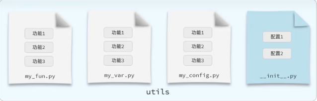

## Python模块

- Python模块：一个.py文件就是一个模块，模块是Python程序的基本组织单位。在模块中可以定义变量、函数、类、以及可执行的代码。

Python 常用模块

| 模块 | 作用 |
| --- | --- |
| `math` | 数学计算 |
| `random` | 随机数与随机选择 |
| `os` | 操作系统相关功能 |
| `sys` | 系统参数与运行环境 |
| `datetime` | 日期和时间处理 |
| `time` | 时间访问与处理 |
| `re` | 正则表达式 |
| `csv` | CSV 文件操作 |
| 自定义模块 | 自己编写并导入使用的 Python 模块 |

 随机点名器

```python
# 随机点名器
import random

# 人物列表
names = [
    "王林", "李慕婉",
    "许立国", "韩立",
    "涛哥", "莫厉海",
    "十三", "虎咆",
    "红蝶", "天运子",
]

print(random.choice(names))
```

`random.choice(names)`：从非空列表 `names` 中随机选择一个元素。

### 导入模块

- 在使用模块中提供的功能之前，必须先导入，再使用。
- 导入模块的具体语法如下：

| 导入形式 | 代码样例 | 调用方式 | 调用示例 |
| --- | --- | --- | --- |
| `import 模块名` | `import random, os` | `模块名.功能名()` | `random.randint(10, 100)` |
| `import 模块名 as 别名` | `import random as rd` | `别名.功能名()` | `rd.randint(10, 100)` |
| `from 模块名 import 功能名` | `from random import randint, choice` | `功能名()` | `randint(10, 100)` |
| `from 模块名 import 功能名 as 别名` | `from random import randint as rint` | `别名()` | `rint(10, 100)` |
| `from 模块名 import *` | `from random import *` | `功能名()` | `randint(10, 100)` |

### 主模块和非主模块

Python 中，主模块是程序本次运行的入口，非主模块是通过 import 导入的模块。

它们的区别由运行方式决定，同一个 .py 文件既可以是主模块，也可以是非主模块，和文件是否叫 main.py 无关。

例如，项目中有两个文件：

```python
project/
├── main.py
└── tools.py
```
执行：

```python
python main.py
```
如果 main.py 导入了 tools.py：

```python
import tools  
```

那么在这次运行中：
- main.py 是主模块。
- tools.py 是非主模块。

如果改为执行：

```python
python tools.py
```
这一次，`tools.py` 就是主模块。

理解它们的关键，是 Python 自动设置的变量 __name__。

__name__ 表示当前模块的名称，它的值取决于模块的加载方式：

| 加载方式 | 模块角色 | 当前模块的 `__name__` |
| --- | --- | --- |
| `python main.py` | `main.py` 是主模块 | `"__main__"` |
| `python tools.py` | `tools.py` 是主模块 | `"__main__"` |
| `import tools` | `tools.py` 是非主模块 | `"tools"` |
| `import utils.tools` | 包中的 `tools.py` 是非主模块 | `"utils.tools"` |

注意：`name` 和 "__main__" 两侧都是两个下划线。

下面通过完整示例观察执行过程。

先编写 `tools.py`：

```python
# tools.py

print("tools.py 的 __name__：", __name__)


def add(a, b):
    return a + b


if __name__ == "__main__":
    print("正在单独测试 tools.py")
    print(add(2, 3))
```

再编写 `main.py`：

```python
# main.py

import tools


def main():
    print("main.py 的 __name__：", __name__)

    result = tools.add(10, 20)
    print("计算结果：", result)


if __name__ == "__main__":
    main()
```

在项目目录执行：

```python
python main.py
```
输出：

```python
tools.py 的 __name__： tools
main.py 的 __name__： __main__
计算结果： 30
```

执行过程如下：
1. Python 运行 main.py，将它的 __name__ 设置为 "__main__"。
2. 遇到 import tools，开始加载并执行 tools.py。
3. tools.py 的 __name__ 是 "tools"，因此它的第一条 print() 执行，`add()` 函数被定义。
4. tools.py 中的 if __name__ == "__main__": 条件不成立，跳过其中的测试代码。
5. 回到 main.py，定义 main()。
6. main.py 中的条件成立，调用 main()，最终得到计算结果 30。

接下来，单独执行：

```python
python tools.py
```
输出：

```python
tools.py 的 __name__： __main__
正在单独测试 tools.py
5
```

因为这次 `tools.py` 是程序入口，所以：

```python
__name__ == "__main__"
```

### 作用域
Python 中，每个模块都有自己的全局作用域。你可以把一个 .py 文件理解为一个独立的“名字空间”，里面保存这个模块定义的变量、函数、类，以及导入的名称。

这里的“全局”是指当前模块内的全局，不同模块的全局变量不会自动共享。

先看两个文件：

```python
# config.py

name = "配置模块"
```

```python
# main.py

import config

name = "主模块"

print(name)
print(config.name)
```
输出：

```python
主模块
配置模块
```

虽然两个文件都有变量 `name`，但它们分别属于不同的模块：

| 名称 | 所属作用域 | 值 |
| --- | --- | --- |
| `main.py` 中的 `name` | `main` 当前运行的模块作用域 | `"主模块"` |
| `config.name` | `config` 模块作用域 | `"配置模块"` |

因此，修改其中一个，不会因为名字相同就自动修改另一个。

模块顶层定义的名称，通常属于模块的全局作用域。
“顶层”指没有写在函数体或类体里面的代码：

```python
# demo.py

import math          # 模块全局名称 math

count = 10           # 模块全局变量 count


def calculate():     # 模块全局名称 calculate
    result = 100     # 函数局部变量 result
    return result


class Student:       # 模块全局名称 Student
    pass
```
其他模块导入后，可以访问这些模块属性：
```python
import demo

print(demo.count)          # 10
print(demo.calculate())    # 100

student = demo.Student()
```

但是不能直接访问函数的局部变量：

```python
print(demo.result)
# AttributeError：demo 模块没有 result 属性
```
因为 result 属于 calculate() 的局部作用域，不属于模块。

### 自定义模块
当开发一些复杂的项目，为了让项目结构更加清晰，更便于项目的维护管理及代码的复用，可能会把一个项目拆分为若干个模块。

Python 自定义模块很简单：创建一个 .py 文件，在里面定义变量、函数或类，再通过 import 导入使用。

例如，把常用的数学计算函数放进一个模块。

先创建下面两个文件，并放在同一个目录中：

```python
project/
├── math_utils.py    # 自定义模块
└── main.py          # 使用模块的程序
```

在 `math_utils.py` 中编写可复用的代码：

```python
# math_utils.py

PI = 3.14159


def add(a, b):
    """返回两个数的和。"""
    return a + b


def circle_area(radius):
    """根据半径计算圆的面积。"""
    return PI * radius ** 2
```
这里定义了一个常量和两个函数。文件名 `math_utils.py` 对应的模块名是` math_utils`，导入时不写 `.py`。

然后，在 `main.py` 中导入并使用：

```python
# main.py

import math_utils

print(math_utils.PI)
print(math_utils.add(10, 20))
print(math_utils.circle_area(2))
```

在项目目录运行：

```python
python main.py
```

输出：

```python
3.14159
30
12.56636
```

使用形式是：

```python
模块名.变量名
模块名.函数名(参数)
```

当模块越来越多时，可以把它们放进一个包中管理。包可以组织多个模块：

```python
project/
├── main.py
└── utils/
    ├── __init__.py
    └── math_utils.py
```

这里的 `__init__.py` 可以先留空，用来把 `utils` 定义为一个普通包。

在` main.py` 中，可以这样导入：

```python
from utils import math_utils

print(math_utils.add(10, 20))
```

也可以直接导入函数： 

```python
from utils.math_utils import add

print(add(10, 20))
```
### 软件包

- 包：本质就是一个文件夹，该文件夹中可以包含若干个python模块(.py文件)，文件夹下还包含了一个`__init__.py`
- 作用：模块文件较多时，用来管理多个模块。(包本质上也是模块)



| 导入形式 | 代码样例 | 调用方式 | 调用示例 |
| --- | --- | --- | --- |
| `import 包名.模块名` | `import utils.my_fun` | `包名.模块名.功能名()` | `utils.my_fun.log_separator1()` |
| `from 包名 import 模块名` | `from utils import my_fun` | `模块名.功能名()` | `my_fun.log_separator1()` |
| `from 包名 import *` | `from utils import *` | 取决于包导出的名称，此例为 `模块名.功能名()` | `my_fun.log_separator1()` |
| `from 包名.模块名 import 功能名` | `from utils.my_fun import log_separator1` | `功能名()` | `log_separator1()` |
| `from 包名.模块名 import *` | `from utils.my_fun import *` | `功能名()` | `log_separator1()` |

> 注意：通过`from 包名.模块名 import *`这个种方式导入包下面所有模块，需要在__init__.py文件中添加__all__=[]